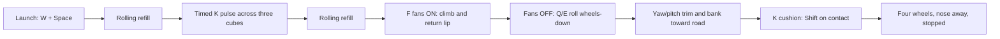

# Continuous Roadster skill course

This is an authored vehicle and course study. Its dimensions, actuator maps and
thermal guard are not a calibrated Tesla stunt replica. The new default finishes
with the nose **away from the ramp**, along world +Z. The earlier explicit
roll/yaw/backward checkpoint remains in commit `df958b5`; an extra half-turn after
this default roll would point the nose toward the ramp.

## Sequence shared by humans and autopilot



The authoritative `seq` is `scenarios/skill_course.rhai`. Modelica provides
measurement gates and digital suggestions in `CoursePilot.mo`; the native-key
adapter and HUD-started autopilot consume those suggestions. Manual play sees
the same goals and suggested controls. Its keys remain direct actuator inputs;
there is no automatic player attitude stabilization. Ctrl+P holds simulation and
course time for inspection.

## Timing and geometry

- Nominal corridor speed: 35 m/s (126 km/h). Falling below 25 m/s after the launch
  gate and before the ramp approach fails the challenge; this never clamps the
  physical speed or steering. Both green services work without stopping.
- Three 3 m cubes, 12 m wide and 2.4 m long, at Z = -100, -112 and -124 m.
  The yellow takeoff line is at -72 m. K closes once measured upward velocity
  passes the pilot's 6.8 m/s cutoff; modeled valve lag contributes residual thrust.
  Typical holds are about 0.3 s. This is not a teleport or prescribed trajectory.
- Crossing is qualified only 3.6 m beyond each cube center, accounting for the
  cube half-length and rear vehicle extent. Native tire/body collision remains
  authoritative. The clearance gate also requires airborne body height >3.0 m.
  A second K pulse cushions touchdown before the next green service; the pilot
  releases motor torque in the air.
- The ramp has an 18 m lower transition arc, 0.9 m wall, 11.7 m upper arc and
  5.4 m lip, reaching 18.873 m. Smooth tangent profiles join level, vertical and
  inverted surfaces. Upper-curve guidance requests 6.5 m/s. The separate original
  ramp practice scene retains its earlier 64.46 m study geometry.
- Ramp colliders are closed standard USD meshes, with existing PhysicsCollisionAPI,
  PhysicsMeshCollisionAPI and bound contact material. Fourteen transverse strips
  replace width-spanning skinny triangles. No collision filtering, contact-law
  relaxation, hidden support force or dependency patch is added.

`author_dynamic_course.py` edits the tracked course documents using OpenFile,
ApplyUsdOps and SaveDocument, then creates early/late fixtures with identical
geometry. Re-run it after regenerating a base course; `author_ramp.py --course`
alone creates the historical base geometry.

## Physical guidance and landing

The pilot uses native body attitude, rates, velocity and measured wheel heading.
It requests ordinary digital steering and valves. Quaternion error and a
finite-torque stopping envelope set attitude rates. Short pitch/roll pulses
approximate angular impulse rather than forcing an orientation.

After roll recovery, lateral position/velocity request a small bank (bounded to
0.24 rad). The actual lift vector then counters sideways drift. Descent braking
uses height, downward speed, mass and current full-bank force. Its conservative
force allowance plans ahead for cooling, while actual useful thrust determines
whether a braking valve may remain open.

Vehicle force, gas mass/energy, tank heat, pressure, changing inertia, aerodynamic
loads, fan forces, tires and suspension retain their plant owners. The two
instant services are explicit game boundaries with mass/thermal accounting.
Finite acceptance uses 250 kg initial air, 293.15 K refill and the existing
200 K study discharge guard. Remaining cold air is not treated as usable thrust.

Completion requires native four-wheel contact, upright attitude, nose alignment
along +Z, position inside the green road area, speed below 0.2 m/s and a 0.5 s
stable dwell. Descent severity is visible telemetry rather than a hidden
completion condition. Modelica retains a filtered near-ground descent measure;
acceptance also samples actual downward speed below 1 m before first contact, with a 5 m/s
acceptance limit. This is a gameplay landing gate, not structural or occupant-safety
qualification.

## Reproduction

```
python3 scripts/check_course_timing.py --binary /path/to/luncosim
python3 scripts/check_keyboard_course.py --launch --manual --binary /path/to/luncosim
python3 scripts/check_keyboard_course.py --launch --manual --autopilot --operator-checks --binary /path/to/luncosim
```

The first command runs the actual shared autopilot and early/late timing cases.
A negative case must produce both a course miss and >100 N s native cube contact
impulse; merely rejecting a checkpoint is insufficient. Nominal acceptance rejects
cube contact. Only the listed timing offsets are established, not an exact full
success window. The two UI clients exercise native Bevy keyboard/pointer delivery
with the original physics; physical OS keyboard delivery remains a human check.

## Requirements and failure ownership

`Roadster::VerifySkillCourse` is registered in `twin.toml`. Seven source-linked
SysML constraints cover continuous speed/completion, clean cube clearance,
rolling services, fan-supported height, upright return-road landing, descent
severity and finite-air/native-mass consistency. The observer binds measured
values to those constraints; limits live in `requirements/roadster.sysml`.
The primary `Roadster::VerifyRunner` launch case remains separate.

The production tree rejects an actual cube impact exceeding 1 N s using native
pair-filtered contact evidence for the chassis and four wheel bodies. Road
contact never counts as cube contact. This is mission policy, not a modified
contact law. Modelica classifies continuous failures (time, launch, carry speed,
refill miss, incomplete roll); the tree latches their code or its native collision
failure, and the HUD names the cause until retry. Landing severity remains an
acceptance quality check, not an additional gameplay failure rule.

The operator acceptance additionally exercises active pause, W takeover and a
native HUD retry after the first rolling service, then completes the course and
stops the completed pilot through its HUD button. It reestablishes manual
stepping after retry because a fresh scene intentionally resets transport state.
